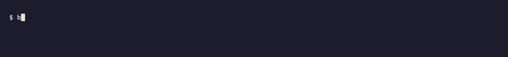

<div align="center">

# 🟤 brownnoise

**Endless, gapless brown noise in your terminal. No loops, no pauses, no browser tab.**

Noise is generated live, sample by sample, so there is no audio file to loop
and nothing to buffer. You just get steady sound for focus or sleep, for as long as you want.

[](https://github.com/krax1337/brownnoise/actions/workflows/ci.yml)
[](https://github.com/krax1337/brownnoise/releases)
[](https://scorecard.dev/viewer/?uri=github.com/krax1337/brownnoise)
[](LICENSE)

[Install](#-install) · [Usage](#-usage) · [Colors & tone](#-colors--tone) · [Security](#-security)



</div>

## ✨ Highlights

- 🔁 **Truly gapless.** No recording, no loop point, no buffering hiccups, so you never hear a seam.
- 🎛️ **Live controls.** Change volume, tone and color while it plays; color changes crossfade smoothly.
- 🎚️ **White, pink and brown,** with a tone knob that makes any of them deeper or brighter at the same loudness.
- 😴 **Sleep timer.** `-t 45m` stops on its own with a gentle 10-second fade-out.
- 🧠 **Remembers you.** It starts next time with the color, volume and tone you quit with.
- 🎧 **Follows your audio.** Plug in headphones or connect AirPods and playback moves with you.
- 🪶 **Tiny.** One ~1 MB binary, no runtime. On Apple Silicon it uses ~17 MB of RAM and well under 1% CPU.
- 🔐 **Verifiable releases.** Signed checksums, SLSA build provenance and an SBOM on every release.

## 🆚 Why not a video or a website?

| | YouTube / streaming | Web players | `sox` one-liner | **brownnoise** |
| --- | :---: | :---: | :---: | :---: |
| No loop seams or buffering pauses | ❌ | ❌ | ✅ | ✅ |
| Works offline, no browser tab | ❌ | ❌ | ✅ | ✅ |
| Change color / tone while playing | ❌ | some | ❌ | ✅ |
| Sleep timer with fade-out | ❌ | some | manual | ✅ |
| Remembers your settings | ❌ | some | ❌ | ✅ |
| No ads, no account, no tracking | ❌ | varies | ✅ | ✅ |

## 📦 Install

### Homebrew (macOS, Linux)

```sh
brew install krax1337/tap/brownnoise
```

### Prebuilt binaries

Download the archive for your platform from the
[latest release](https://github.com/krax1337/brownnoise/releases/latest),
extract it and put `brownnoise` on your `PATH`.

| Platform              | Archive                                              |
| --------------------- | ---------------------------------------------------- |
| macOS (Apple Silicon) | `brownnoise-vX.Y.Z-aarch64-apple-darwin.tar.gz`      |
| macOS (Intel)         | `brownnoise-vX.Y.Z-x86_64-apple-darwin.tar.gz`       |
| Linux (x86_64)        | `brownnoise-vX.Y.Z-x86_64-unknown-linux-gnu.tar.gz`  |
| Linux (aarch64)       | `brownnoise-vX.Y.Z-aarch64-unknown-linux-gnu.tar.gz` |
| Windows (x86_64)      | `brownnoise-vX.Y.Z-x86_64-pc-windows-msvc.zip`       |

On Linux the binary needs the ALSA runtime (`libasound2` on Debian/Ubuntu,
`alsa-lib` on Fedora and Arch), which desktop systems already have.

### Cargo

```sh
cargo install --locked --git https://github.com/krax1337/brownnoise
```

Requires Rust 1.85+. On Linux, install `libasound2-dev` and `pkg-config` first
(Fedora: `alsa-lib-devel pkgconf`, Arch: `alsa-lib pkgconf`).

## 🚀 Usage

```sh
brownnoise                      # last used settings (brown, 50% on first run)
brownnoise -c pink -v 30        # pink noise at 30% volume
brownnoise --tone 20            # deeper, darker sound
brownnoise -t 45m               # stop after 45 minutes
brownnoise -c brown -t 1h30m    # fall asleep to brown noise
```

### Options

| Option                 | Description                                                         | Default                 |
| ---------------------- | ------------------------------------------------------------------- | ----------------------- |
| `-c, --color <COLOR>`  | `white`, `pink` or `brown`                                          | last used, else `brown` |
| `-v, --volume <0-100>` | Starting volume                                                     | last used, else `50`    |
| `--tone <0-100>`       | `0` deepest, `50` neutral, `100` brightest                          | last used, else `50`    |
| `-t, --timer <DUR>`    | Stop after `DUR` with a 10 s fade: `45m`, `1h30m`, `90s`, `20` (min) | play until you quit     |
| `-h, --help`           | Print help                                                          |                         |
| `-V, --version`        | Print version                                                       |                         |

### Keys

| Key                                | Action                       |
| ---------------------------------- | ---------------------------- |
| `↑` / `↓`, `+` / `-` or `k` / `j`  | Volume up / down             |
| `←` / `→` or `h` / `l`             | Tone deeper / brighter       |
| `r`                                | Reset tone to neutral (50)   |
| `w` / `p` / `b`                    | White / pink / brown noise   |
| `c` or `Tab`                       | Cycle color                  |
| `space`                            | Pause / resume               |
| `q`, `Esc` or `Ctrl+C`             | Quit with a short fade-out   |

Run it in the background (`brownnoise -t 1h &`) and it plays without the UI
until the timer ends or it receives `SIGINT` / `SIGTERM`.

## 🎨 Colors & tone

- **White**: equal energy at every frequency. Bright and hissy, like TV static.
- **Pink**: −3 dB per octave. Balanced and soft, like steady rain.
- **Brown**: −6 dB per octave. A deep, low rumble, like a waterfall or distant surf.

The **tone** knob tilts any color deeper or brighter (±18 dB above ~350 Hz).
Every color and tone setting is normalized to the same loudness, so you can
explore without volume jumps. Left and right channels are generated
independently for a wide stereo image.

## ⚙️ Configuration

The color, volume and tone you quit with are saved and used next time.
Command-line flags override them for that run.

| Platform     | Path                                                                                |
| ------------ | ----------------------------------------------------------------------------------- |
| macOS, Linux | `$XDG_CONFIG_HOME/brownnoise/config.toml`, else `~/.config/brownnoise/config.toml` |
| Windows      | `%APPDATA%\brownnoise\config.toml`                                                  |

Delete the file to return to the defaults.

## 🔐 Security

- Release archives come with a cosign-signed `SHA256SUMS`, GitHub/SLSA build
  provenance and an SPDX SBOM. See [SECURITY.md](SECURITY.md#verifying-release-artifacts)
  for the verification commands.
- CI runs CodeQL, `cargo-deny` (RustSec advisories, licenses, sources), `zizmor`
  for workflow security and the OpenSSF Scorecard. All actions are pinned to commit SHAs.
- Found a vulnerability? Please report it
  [privately](https://github.com/krax1337/brownnoise/security/advisories/new),
  not in a public issue.

## 🤝 Contributing

Issues and pull requests are welcome. See [CONTRIBUTING.md](CONTRIBUTING.md).
If brownnoise helps you focus or sleep, a ⭐ helps others find it.

## 📄 License

[MIT](LICENSE) © 2026 Asanali Bulatov
